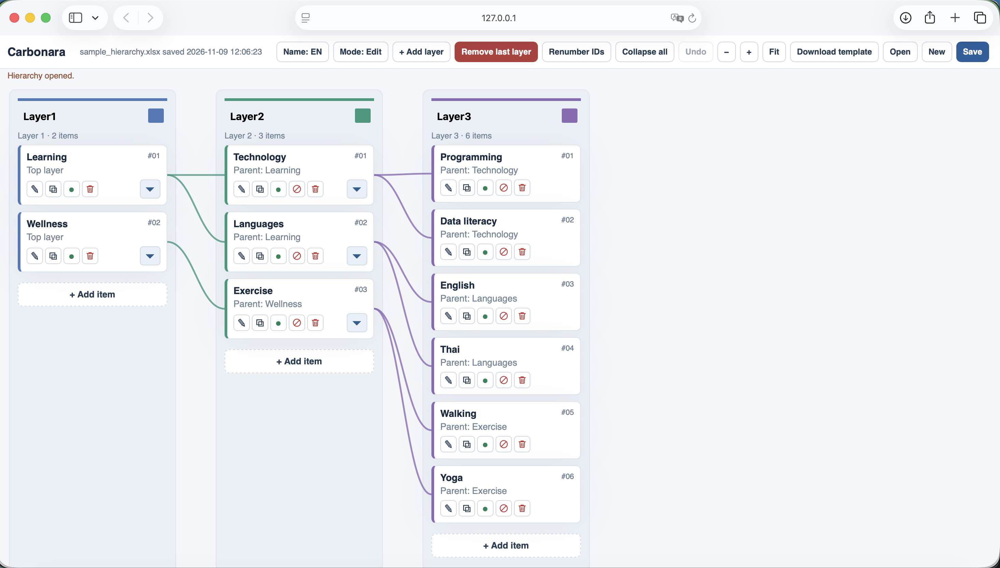

# Carbonara

Carbonara is a visual editor for organizing information into hierarchies. Use it to map topics, plan projects, organize learning materials, or show relationships between categories and items. It can also help organize product data, knowledge bases, and content for AI pipelines. It supports up to five layers, English and Thai names, and Excel workbooks.



## Install

Install Python 3 and download or clone this repository. Open a terminal in the Carbonara folder, then install the requirements:

```sh
python3 -m venv .venv
.venv/bin/python -m pip install -r requirements.txt
```

On Windows, use these commands instead:

```powershell
python -m venv .venv
.\.venv\Scripts\python.exe -m pip install -r requirements.txt
```

## Start the app

From the Carbonara folder, run:

```sh
.venv/bin/python server.py
```

On Windows, run `.\.venv\Scripts\python.exe server.py` instead. The app opens in your browser. If it does not, visit [http://127.0.0.1:8766/](http://127.0.0.1:8766/). Leave the terminal open while using the app; press **Ctrl+C** there to stop it.

The sample hierarchy opens on first use. After that, Carbonara reopens the workbook you last opened or saved.

## Use Carbonara

1. Explore the sample, select **New** for an empty hierarchy, or select **Open** to open a Carbonara workbook.
2. Rename layers or change their colors. Add or remove layers as needed.
3. Select **Add item** and enter an English name. Thai names, definitions, and remarks are optional.
4. Connect each active item to a parent in the preceding layer using the item editor or **Connect**. Drag items to reorder them.
5. Use **Mode** to switch to a compact view, **Name** to switch languages, and the zoom and collapse controls to explore the board.

Use **Download template** to get a blank Excel workbook in Carbonara's format. Keep its `summary` and hidden `_hierarchy` sheets so Carbonara can reopen it.

## Save your work

Select **Save** and confirm. A new hierarchy is saved as an Excel workbook in the `hierarchy` folder; an opened workbook is updated in its original location. Use **New** before saving if you want a separate file rather than overwriting the sample or another open workbook. Close the workbook in Excel if it is locked.

## Contact

Email: [chaiwat.nati@gmail.com](mailto:chaiwat.nati@gmail.com)
